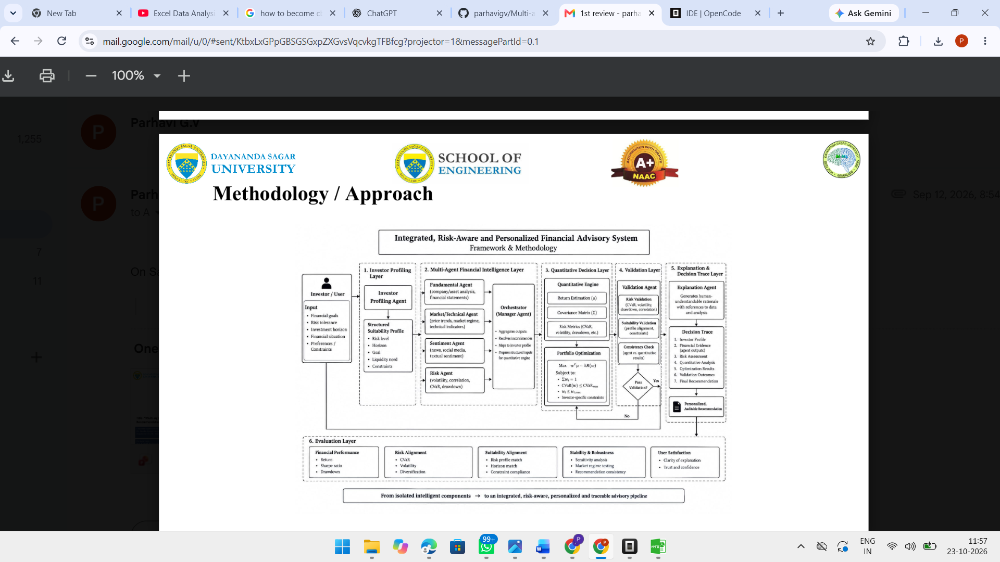

# Multi-Agent Financial Advisor for Portfolio Analysis, Risk Assessment and Recommendation

[](https://www.python.org/downloads/)
[](LICENSE)
[](tests/)
[](#limitations)

A research prototype for suitability-aware portfolio advice with an auditable
decision path. It combines a constrained quantitative optimizer, rule-based or
grounded-LLM analysts, Black-Litterman view blending, a blocking suitability
gate, and a tamper-evident local audit chain.

The project asks a narrow evaluation question:

> Once the comparison includes 1/N and 60/40 benchmarks, a fair
> suitability-gated quantitative baseline, transaction costs, five investor
> profiles and uncertainty intervals that respect serial dependence, do the
> coordinated agent views add measurable value?

The current real-data answer is **no clear alpha advantage**. The hybrid is
approximately indistinguishable from the same optimizer and gate with neutral
views. That negative result is part of the contribution; the repository reports
it rather than hiding it.

**This is not production software and not investment advice.** See
[Limitations](#limitations).

## Contents

- [What is implemented](#what-is-implemented)
- [Architecture](#architecture)
- [Evaluation design](#evaluation-design)
- [Real-data results](#real-data-results)
- [Where the hybrid does not beat baselines](#where-the-hybrid-does-not-beat-baselines)
- [Forecast final-test readout](#forecast-final-test-readout)
- [Data split](#data-split)
- [Traceability](#traceability)
- [Quick start](#quick-start)
- [Reproducing the evidence](#reproducing-the-evidence)
- [Limitations](#limitations)
- [Repository layout](#repository-layout)
- [Documentation](#documentation)
- [Tests](#tests)
- [License and authors](#license-and-authors)

## What is implemented

- **Multi-agent advisory pipeline.** Market, fundamental, sentiment, risk and
  portfolio analysts produce typed signals plus dated evidence. A coordinator
  turns their views into tilts and records disagreement.
- **Grounded optional LLM analysts.** Strict schemas, per-signal fact-sheet
  citations, numeric grounding and deterministic fallback. The LLM cannot
  choose weights, invent metrics or write final evidence.
- **Black-Litterman blending.** Agent tilts become absolute views with
  confidence-scaled uncertainty. A per-asset movement cap and a global L1
  influence cap bound how far narrative conviction can move the quantitative
  prior.
- **Constrained optimization.** Mean-variance, minimum-variance, risk-parity
  and minimum-CVaR under long-only, position caps, sector caps, exclusions and
  turnover regularization. Every run reports an explicit `solver_status`; a
  failed SLSQP solve returns a constraint-aware fallback instead of an
  unchecked weight vector.
- **Suitability gate and repair.** Deterministic policy checks for equity
  exposure, volatility, CVaR, drawdown, single-position limits, sector limits,
  diversification, exclusions and liquidity. A breaching book is repaired with
  bounded iterations; the gate can still fail honestly when the policy cannot
  be met on realized data.
- **Explainability.** Variance and return contribution, agent contribution,
  binding constraints, suitability rationale and a risk-class counterfactual
  are attached to the recommendation.
- **Tamper-evident audit trail.** Each stage records input/output digests. The
  completed trace is hashed and chained to the previous trace. Verification
  detects edited recommendation bodies and broken hash links. It is
  tamper-evident within the local chain, not a write-once ledger and not
  externally notarized.
- **No-lookahead data access.** Market snapshots are cut at the decision date;
  forecast features are lagged; evaluation splits use purge and embargo where
  overlapping targets require it.

## Architecture



The advisory path is:

```
investor profile
  -> point-in-time market snapshot
  -> quantitative features
  -> independent analyst reports + signals
  -> coordinator tilts and agreement
  -> Black-Litterman posterior expected returns
  -> constrained optimizer
  -> blocking suitability gate / repair
  -> explanation and counterfactual
  -> recommendation with sealed audit hash
```

A worked example of that exact path, including the final hash and stage
digests, is in [results/trace_example.md](results/trace_example.md).

## Evaluation design

The advisory panel is a **pre-specified walk-forward analysis** over the
available real ETF history (`2018-01-01` through `2026-06-30`), not a
train/validation/test model-selection experiment. Decisions are made every 21
trading days from a 252-day lookback. Every strategy starts from cash, pays the
same initial build cost, uses the point-in-time FRED 3-month T-bill rate and
pays 12 bps of linear transaction cost.

The panel spans five investor profiles whose binding suitability classes are
1 through 5. Seven configurations share the same market calendar:

| Configuration | Agent views | Optimizer | Suitability gate |
|---|---|---|---|
| `one_over_n` | none | equal weight | no |
| `sixty_forty` | none | 60% equal-weight equity / 40% equal-weight fixed income | no |
| `min_variance` | none | constrained minimum variance | no |
| `quant_only_no_gate` | neutral | constrained mean-variance, quantitative prior | no |
| `quant_only_gated` | neutral | same optimizer as hybrid | **yes** |
| `agents_only` | yes | mean-variance from agent views | no |
| `hybrid` | yes | Black-Litterman + constrained mean-variance | **yes** |

`quant_only_gated` is the fair baseline for the agent-value question: it has the
same optimizer, costs and gate as `hybrid`, but neutral views. `quant_only_no_gate`
isolates the gate. `one_over_n` and `sixty_forty` are strategic benchmarks, not
just strawmen.

Confidence intervals use a moving-block bootstrap with 21-day blocks and 1,000
replicates. Paired tests resample the same block indices for hybrid and each
baseline. The reported p-value is a two-sided percentile bootstrap p-value, not
an exact finite-sample test. No multiple-testing correction is applied.

The generated evidence is [results/evaluation.md](results/evaluation.md) and
[results/evaluation.json](results/evaluation.json), with the same run also
published as `results/phase4_evaluation.*`. The full protocol and per-profile
tables are in [docs/EVALUATION.md](docs/EVALUATION.md).

## Real-data results

Mean across the five investor profiles, real prices, point-in-time risk-free
rate and 12 bps costs:

| Configuration | Annual return | Annual vol | Sharpe | Max drawdown | Turnover / rebalance | Annual cost | Suitability breach |
|---|---:|---:|---:|---:|---:|---:|---:|
| `one_over_n` | 12.8% | 14.5% | 0.66 | -30.1% | 0.6% | 0.8 bps | 50% |
| `sixty_forty` | 10.0% | 11.6% | 0.58 | -23.8% | 0.6% | 0.8 bps | 47% |
| `min_variance` | 5.1% | 8.0% | 0.24 | -18.3% | 5.0% | 7.2 bps | 60% |
| `quant_only_no_gate` | 13.0% | 13.8% | 0.70 | -26.4% | 10.2% | 14.8 bps | 56% |
| `quant_only_gated` | 9.0% | 11.2% | 0.45 | -24.9% | 8.2% | 11.9 bps | 41% |
| `agents_only` | 7.4% | 13.3% | 0.33 | -27.9% | 76.1% | 110.5 bps | 74% |
| `hybrid` | **9.1%** | **11.3%** | **0.46** | **-24.9%** | **8.0%** | **11.7 bps** | **40%** |

Source: `results/evaluation.md` aggregate table, generated from
`results/evaluation.json`. Values are rounded exactly as printed in that report.

### Uncertainty intervals

Intervals are per-profile and are not aggregate confidence intervals. The table
shows the balanced-growth profile (`P3-BALANCED`) because it is the middle
suitability class (3 of 5) and its estimates are close to the panel average. The
full 35 profile/configuration interval table is in
[results/evaluation.md](results/evaluation.md).

| Configuration | Sharpe [95% CI] | Max drawdown [95% CI] |
|---|---:|---:|
| `hybrid` | 0.52 [-0.28, 1.39] | -24.7% [-43.9%, -10.6%] |
| `quant_only_gated` | 0.50 [-0.29, 1.40] | -24.8% [-44.7%, -10.1%] |
| `sixty_forty` | 0.58 [-0.20, 1.49] | -23.8% [-39.8%, -9.1%] |
| `one_over_n` | 0.66 [-0.13, 1.61] | -30.1% [-49.1%, -10.5%] |

The hybrid interval includes zero and overlaps the fair baseline almost
completely. The point estimate is not evidence of a reliable edge.

### What the panel does show

- **The gate does real risk work.** The same optimizer without the gate
  (`quant_only_no_gate`) has a higher raw Sharpe (0.70) but a 56% breach rate
  and a -26.4% max drawdown. The gate reduces breaches to 41% and drawdown to
  -24.9%, at the cost of return and Sharpe. That is a suitability trade-off, not
  alpha.
- **Agent views without guardrails are costly.** `agents_only` turns over 76%
  per rebalance, costs 110.5 bps per year and breaches suitability 74% of the
  time. Holding-aware portfolio views make it churn.
- **The regime windows are mixed.** In the fixed 2020 crash window hybrid
  returned -6.2% versus -7.8% for 60/40; in the 2022 rate shock it returned
  -5.8% versus -9.2% for 60/40. These windows were not selected from the
  results, but they are short and descriptive.

## Where the hybrid does not beat baselines

This is the central honesty check, stated plainly:

1. **Against the fair quantitative baseline.** Hybrid annual return is 9.1%
   versus 9.0%, volatility 11.3% versus 11.2%, Sharpe 0.46 versus 0.45, and max
   drawdown is identical at -24.9%. Hybrid turnover is 8.0% versus 8.2%, annual
   cost 11.7 versus 11.9 bps, and breach rate 40% versus 41%. The differences
   are economically negligible and statistically unresolved.
2. **Against 60/40.** Hybrid returns 9.1% versus 10.0%, with a slightly worse
   max drawdown (-24.9% versus -23.8%). Beating a weak 1/N strawman is not the
   claim; hybrid does not beat the simple strategic benchmark either.
3. **Against 1/N.** Equal weight returns 12.8% with a 0.66 Sharpe, although with
   a -30.1% drawdown and a 50% breach rate. Any risk-adjusted value claim has to
   explain why it accepts lower return and similar drawdown.
4. **Paired tests.** At the 5% level before any correction, 4 of 30
   hybrid-vs-baseline Sharpe differences and 2 of 30 max-drawdown differences
   have p < 0.05. The directions are mixed: some favor hybrid, some favor the
   baseline. With 30 comparisons, this is consistent with descriptive noise. No
   family-wise significance claim is made.
5. **No aggregate alpha claim.** The five-profile panel is a robustness device,
   not five independent markets. The intervals are wide, the profiles share the
   same price history, and the bootstrap respects serial dependence but cannot
   create independent samples.

## Forecast final-test readout

The forecast models use a purged, embargoed expanding walk-forward with a fixed
split: dev through `2021-12-31`, validation `2022-01-01` to `2023-12-31`, and
test from `2024-01-01`. Model selection uses validation only. The test window is
added once for the final report and never used to re-select.

The selected models remain `shrunk_mean` for returns and `ewma` for volatility.
The test results are mixed, and the volatility result is partly worse:

| Task | Selected model | Metric | Validation | Test |
|---|---|---|---:|---:|
| Return | `shrunk_mean` | Rank IC | 0.0613 | 0.0977 |
| Return | `shrunk_mean` | RMSE | 0.0564 | 0.0436 |
| Return | `shrunk_mean` | MAE | 0.0445 | 0.0321 |
| Volatility | `ewma` | QLIKE (lower better) | -2.4874 | -2.7941 |
| Volatility | `ewma` | RMSE (lower better) | 0.0531 | **0.0704 (worse)** |
| Volatility | `ewma` | MAE (lower better) | 0.0419 | **0.0440 (worse)** |

Interpretation:

- Return rank IC and absolute return errors are better in the test window than
  in validation. That is a positive readout, not proof of stable skill.
- Volatility QLIKE improves, but QLIKE is a scale-free variance objective. The
  absolute volatility RMSE and MAE both worsen. The forecast is not uniformly
  better out of sample.
- `har` has a lower test RMSE (`0.0649`) than `ewma` (`0.0704`), but a slightly
  worse test QLIKE (`-2.7909` versus `-2.7941`). Because the pre-registered
  selection rule is validation QLIKE, `ewma` remains selected. Switching to
  `har` after seeing test would be test-set selection, so we do not do it.

Source: [results/forecast_report.md](results/forecast_report.md) and its JSON.
The full leakage controls and the rule that test inclusion cannot change the
selected models are in [docs/FORECASTING.md](docs/FORECASTING.md).

## Data split

| Purpose | Dev / train | Validation | Test |
|---|---|---|---|
| Forecast model selection and diagnostics | through `2021-12-31` | `2022-01-01` to `2023-12-31` | from `2024-01-01` |
| Advisory walk-forward readout | same fixed dates, descriptive only | same fixed dates, descriptive only | same fixed dates, descriptive only |

The advisory strategies are **not trained** on dev or validation and are **not
selected** on test. Their walk-forward weights are produced from rolling
point-in-time windows. The split labels are applied to their return paths only
to make the final readout auditable. The advisory test-window result is:

- Hybrid annual return **14.3%** in test versus **1.6%** in validation.
- Hybrid Sharpe **1.00** versus **-0.21**.
- Hybrid test max drawdown **-8.9%**.

This is a descriptive out-of-sample readout, not a tuned improvement. The
validation period was weak for almost every configuration, and the test period
was strong for almost every configuration, including 1/N and 60/40. The full
panel is the relevant evidence, and it does not support a stable agent alpha
claim. The complete split table is in
[results/evaluation.md](results/evaluation.md).

## Traceability

A reviewer can follow one recommendation without reading the whole codebase:

1. **Profile** - hashed into `profile_digest` and normalised by the suitability
   policy.
2. **Agent signals** - typed signals with subject, direction, strength,
   confidence and dated evidence.
3. **Black-Litterman** - prior, per-asset view, posterior and confidence, plus
   the total-influence cap.
4. **Optimizer** - weights, `solver_status`, expected return/volatility/Sharpe,
   binding constraints and the risk-free rate actually used.
5. **Suitability gate** - every rule with observed value, limit, pass/fail,
   severity and remediation.
6. **Explanation** - agent contribution, variance/return contribution,
   suitability rationale and counterfactual.
7. **Audit hash** - stage input/output digests, previous hash and final hash,
   plus chain verification.

The generated worked example is
[results/trace_example.md](results/trace_example.md), with the full trace body
in [results/trace_example.json](results/trace_example.json). It is produced by
`scripts/run_trace_example.py` on the deterministic synthetic provider, so it
is an audit demonstration rather than market evidence. The trace id, timestamp
and hash are unique to each run.

The audit chain is tamper-evident. It detects an edited recommendation body or
a broken `previous_hash` link. It does not prevent an attacker with write access
from deleting the whole local chain, and it has no external timestamp or
notary. [docs/AUDIT.md](docs/AUDIT.md) records that boundary explicitly.

## Quick start

```bash
git clone https://github.com/parhavigv/Multi-agent-financial-advisor-for-protfolio-analysis-risk-assesemet-and-financial-recomandation.git
cd Multi-agent-financial-advisor-for-protfolio-analysis-risk-assesemet-and-financial-recomandation

python -m venv .venv
# Windows:
.venv\Scripts\activate
# macOS/Linux:
# source .venv/bin/activate

pip install -r requirements.txt
pip install -e .
```

Generate one recommendation:

```bash
intellivest-advise
intellivest-advise --profile path/to/profile.json
intellivest-advise --json
intellivest-advise --ml       # opt-in forecast overlay
```

Run the research evaluation:

```bash
intellivest-evaluate
intellivest-evaluate --no-bootstrap   # fast smoke run
```

### Real data

The default provider is a deterministic synthetic market so the test suite and
demos run offline. Real evaluation uses 14 US ETFs and the FRED 3-month T-bill:

```bash
python scripts/fetch_real_data.py
intellivest-evaluate
```

The price and risk-free cache files are gitignored. See
[docs/REAL_DATA.md](docs/REAL_DATA.md) for the ticker mapping, point-in-time
rules and the sentiment-agent abstention when real news is not wired in.

## Reproducing the evidence

```bash
# 1. Real market data and point-in-time risk-free series
python scripts/fetch_real_data.py

# 2. Forecast report; this is the only run that includes test
python scripts/run_forecast_evaluation.py --include-test

# 3. Advisory panel with bootstrap intervals and paired tests
python scripts/run_evaluation.py

# 4. One fully linked audit trace
python scripts/run_trace_example.py

# 5. Tests
python -m pytest -q
```

Outputs:

- `results/forecast_report.md` / `.json`
- `results/evaluation.md` / `.json`
- `results/phase4_evaluation.md` / `.json`
- `results/trace_example.md` / `.json`

The README numbers are taken from those generated files. The evaluation is
deterministic given the cached data, settings and fixed seeds; the audit trace
timestamp and hash change on each run by design.

## Limitations

- **Research prototype, not production.** No authentication, multi-tenant
  isolation, regulatory reporting, suitability certification, broker
  integration or operational monitoring.
- **Not investment advice.** The outputs are research artifacts. A human
  adviser and the investor remain responsible for any decision.
- **One market, one universe, one sample.** The real evaluation covers 14
  liquid US ETFs over a single 2018-2026 path. It is not evidence across
  countries, asset classes, market microstructures or investor populations.
- **Advisory design is not a clean pre-registered trial.** The walk-forward is
  fixed and no parameter is estimated from the test window, but the project was
  developed across phases and the hypotheses were refined along the way. Treat
  the p-values as descriptive, not confirmatory.
- **Wide uncertainty.** Per-profile bootstrap intervals often include zero. The
  five profiles share the same prices, so they are not independent replications.
- **Multiple comparisons.** Thirty paired Sharpe tests and thirty paired
  drawdown tests are reported without family-wise correction.
- **Costs are simple.** A linear 12 bps charge, no market impact, taxes, bid-ask
  spread dynamics, borrow costs or capacity constraints.
- **Suitability policy is a prototype.** The thresholds are deterministic
  research choices, not legal or regulatory advice. Class-1 capital-preservation
  profiles can remain infeasible on realized data; the gate reports that rather
  than silently passing.
- **Agents are mostly rule-based.** The default analysts are deterministic. The
  optional LLM path is grounded and schema-constrained, but its performance is
  not validated as an alpha source.
- **Forecast degradation is real.** The selected volatility model has worse
  test RMSE and MAE than validation. QLIKE improves, but that does not make the
  absolute forecast closer.
- **Audit boundary.** The local hash chain is tamper-evident only. It is not a
  write-once ledger, externally anchored or a substitute for a trusted
  timestamping service.
- **No live-trading evidence.** No paper trading, execution simulation or
  out-of-sample live deployment has been run.
- **No causal claims.** Regime windows and profile differences are descriptive
  associations, not identified causal effects.

## Repository layout

```
multi-agent-financial-advisor/
├── intellivest/
│   ├── agents/           # deterministic and grounded-LLM analysts
│   ├── api/              # FastAPI surface
│   ├── data/             # synthetic and real market providers
│   ├── evaluation/       # backtest, bootstrap, profiles, splits, Phase 4
│   ├── explain/          # attribution and counterfactual helpers
│   ├── forecasting/      # purged walk-forward return/vol/regime models
│   ├── ml/               # opt-in bridge to validated forecasts
│   ├── orchestration/    # coordinator, advisory engine, trace and audit chain
│   ├── personalization/  # suitability policy and repair
│   ├── quant/            # optimizer, Black-Litterman, risk analytics
│   ├── cli.py
│   ├── config.py
│   └── contracts.py
├── docs/                 # evaluation, forecasting, agents, audit, real data
├── scripts/              # data fetch, evaluation, forecast, trace example
├── tests/                # 96 tests
├── results/              # versioned evidence and trace example
├── audits/               # local audit records (gitignored)
└── pyproject.toml
```

## Documentation

- [Evaluation protocol and per-profile results](docs/EVALUATION.md)
- [Forecast evaluation, leakage controls and test readout](docs/FORECASTING.md)
- [Agent grounding and LLM fallback](docs/AGENTS.md)
- [Audit scope and phase resolutions](docs/AUDIT.md)
- [Real-data mapping and no-lookahead rules](docs/REAL_DATA.md)

## Tests

The suite covers no-lookahead snapshots, audit-chain tamper detection, numeric
grounding, optimizer feasibility and fallback status, position/sector caps,
risk-free Sharpe consistency, metrics on known series, suitability repair,
forecast leakage controls, and the full profile-to-audit-hash trace.

```bash
python -m pytest -q
```

Current suite: **96 tests passing** on Python 3.10.11.

## License and authors

MIT License. See [LICENSE](LICENSE).

- Parhavi G.V
- Akkihebbal Bhargava Surya
- Mekala Kirthana
- Shefali Chimmanda Ganapati

For questions or issues, use the
[GitHub issue tracker](https://github.com/parhavigv/Multi-agent-financial-advisor-for-protfolio-analysis-risk-assesemet-and-financial-recomandation/issues).
